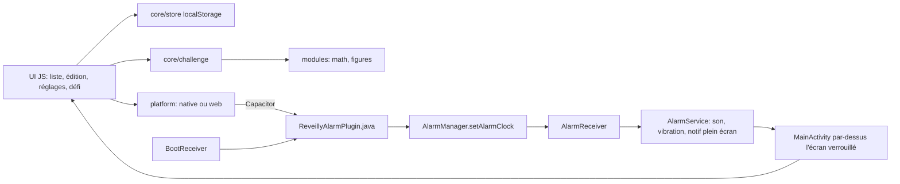

# Reveilly — Architecture technique

> Version 1 · 2026-10-23

## 1. Résumé

| Couche | Choix | Pourquoi | Alternative écartée |
|---|---|---|---|
| Interface | HTML/CSS/JS sans framework, bundlé par Vite | Les modules fournis sont déjà en JS ; 5 écrans ne justifient pas React | React Native : réécriture complète des modules |
| Coquille mobile | Capacitor 8 (Android) | Réutilise le code Web tel quel, accès natif par plugin | PWA seule : une page Web ne peut pas sonner application fermée |
| Sonnerie | Plugin Java maison `ReveillyAlarm` (AlarmManager + service au premier plan) | Seul moyen fiable de sonner en boucle écran verrouillé | Notifications locales : son limité, pas de boucle ni de plein écran garanti |
| Logique | Modules ES (`src/core`, `src/modules`) testés hors interface | Testables sous Node | — |
| Stockage | `localStorage` (alarmes, réglages) + `SharedPreferences` côté natif (copie pour la reprogrammation) | Quelques Ko, pas de requêtes | SQLite : surdimensionné |
| Serveur / services | Aucun | Tout est local et hors ligne | — |
| Tests | Vitest (unitaires) + scénarios manuels sur appareil | Rapide, sans navigateur | — |
| Distribution | APK signé, installé à la main (H5) ; Play Store plus tard (D3) | Pas de compte développeur nécessaire pour tester | — |

## 2. Contexte existant

Nouveau projet. Reprise des deux pages fournies : leurs générateurs et banques de questions sont extraits tels quels dans `src/modules/` (contenu inchangé), l'interface est refaite selon UI.pdf.

## 3. Composants



La couche `platform` a deux implémentations : **native** (Capacitor) et **web** (aperçu navigateur : minuterie + Web Audio, ne sonne que page ouverte).

## 4. Local ou serveur

| Fonction | Où elle s'exécute | Service externe | Clé secrète | Repli si indisponible |
|---|---|---|---|---|
| Planification et sonnerie | Local (natif) | Aucun | Non | Aperçu Web : page ouverte uniquement |
| Génération et correction des questions | Local (JS) | Aucun | Non | — |
| Stockage | Local | Aucun | Non | — |

## 5. Modèle de données

```js
Alarm = { id, label, hour, minute, days: [0..6] /* 0 = lundi */, enabled,
  sound: { kind: 'default'|'beep'|'file', uri?, name? }, volume: 0..1, vibrate,
  challenge: { math: { on, themes: [ids], count }, figures: { on, themes: [ids], mode: 'qcm'|'saisie', count } } }
Settings = { rampSeconds, maxRingMinutes, haptics }
```

Côté natif, chaque alarme active est stockée en JSON minimal (`id, hour, minute, days, label, soundUri, volume, vibrate`) pour reprogrammer seule après un redémarrage.

## 6. Interfaces et intégrations

Interface d'un module de questions (`src/modules/*.js`) :

```js
{ id, name, short, themes: [{id, label}], modes?: [{id, label}],
  generate({ themes, mode }, rng) -> { prompt /*HTML*/, input: 'number'|'text'|'choice', choices?, check(answer) -> { ok, note?, solution /*HTML*/ } } }
```

Ajouter un module = un fichier + une ligne dans `src/modules/index.js`.

Plugin natif `ReveillyAlarm` : `sync({alarms, settings})`, `getRinging()`, `stopRinging({id})`, `scheduleTest({seconds})`, `pickSound()`, `previewSound`/`stopPreview`, `checkPermissions()`, `openSettings({what})`. Événement `ringing` quand l'app est déjà ouverte.

## 7. Authentification et permissions

Pas de compte. Permissions Android listées dans FEATURES_AND_ACCEPTANCE.md §5. `USE_EXACT_ALARM` est réservée aux applications dont la fonction principale est le réveil : c'est le cas, mais à déclarer si publication Play **[À vérifier]** au moment de D3 (https://developer.android.com/training/scheduling/alarms). Depuis Android 14, `USE_FULL_SCREEN_INTENT` n'est accordée d'office qu'aux applications d'appel et d'alarme (https://source.android.com/docs/core/permissions/fsi-limits).

## 8. Sécurité, validation et erreurs

Tout texte affiché passe par `esc()` ; données relues du stockage validées et complétées par des valeurs par défaut (`normalizeAlarm`) ; aucune entrée réseau. Erreurs natives captées et affichées en avertissement.

## 9. Dépendances

| Dépendance | Rôle | Licence | Coût | Alternative |
|---|---|---|---|---|
| @capacitor/core, cli, android 8.5 | Coquille native | MIT | 0 | — |
| Vite 8, Vitest 5 | Build, tests | MIT | 0 | — |
| @fontsource/cabin | Police proche de la maquette, embarquée hors ligne | OFL | 0 | Police système |

## 10. Tests

`npm test` : dates (`nextOccurrence`), magasin d'alarmes, filtres des modules, correction (nombres, fractions, fautes), session de défi, courbe de volume. Le natif se teste à la main (RISKS_AND_TESTS.md §5).

## 11. Build, déploiement et maintenance

`npm run build && npx cap sync android`, puis Android Studio (ou `npm run apk`, qui appelle `gradlew.bat` sous Windows). Exige le SDK Android 36 et JDK 21.

## 12. Coûts récurrents

| Poste | Coût | Source |
|---|---|---|
| Hébergement | 0 (aucun serveur) | — |
| Compte Google Play (si D3 = oui) | Frais unique [À vérifier] | https://support.google.com/googleplay/android-developer |

## 13. Décisions d'architecture

- **ADR-1 — Capacitor + plugin natif maison** : garde le JS des modules et donne une sonnerie de vrai réveil. Pas de plugin tiers d'alarme : leur maintenance n'est pas vérifiée.
- **ADR-2 — Le natif calcule lui-même la prochaine occurrence** : l'alarme récurrente se reprogramme même si l'app n'est jamais rouverte.
- **ADR-3 — Couche `platform` Web** : permet de tester toute l'interface et les défis dans un navigateur.

## 14. Arborescence proposée

```
reveilly/
  index.html  vite.config.js  capacitor.config.json  package.json
  src/main.js  src/styles.css
  src/core/      time.js store.js challenge.js util.js audio.js
  src/modules/   index.js math.js figures.js
  src/platform/  index.js web.js native.js
  src/ui/        list.js edit.js settings.js ring.js wheel.js dom.js
  tests/         *.test.js
  android/app/src/main/java/app/reveilly/  ReveillyAlarmPlugin.java AlarmScheduler.java AlarmReceiver.java AlarmService.java BootReceiver.java MainActivity.java
  product/
```
